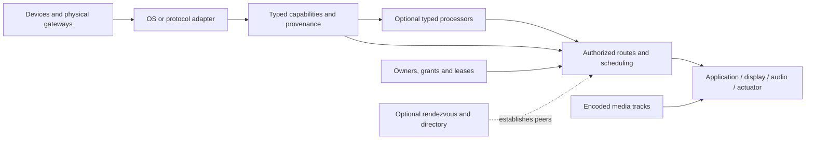

# Universal device and signal platform design

Status: platform architecture with embedded stage 1 implemented, 1 October 2026. Original runtime baseline: `9c422e21b7b1d33e323f100436fc29963af7c43c`. Later stages remain planned; implementation evidence is in [the foundation QA record](../../platform/FOUNDATION-QA-2026-10-01.md).

## Outcome and scope

A developer can build an application by describing capabilities, connections, processing and screens. Consenting device owners can combine resources from different devices nearby or across the internet. The same contracts support games, remote pointers, appliance controls, robotics interfaces, sensor dashboards and collaboration. 101 becomes a maintained consumer and reference application of that platform.

The user's requirements are a reusable open SDK; readable syntax and examples; multiple simultaneous inputs/outputs; heterogeneous sensors and devices, including legacy hardware behind gateways; global secure connections; small efficient payloads; extensible connectors and algorithms; responsive polished UI; explicit sharing and conflict behavior. The proposed foundation is an open SDK with native adapters and an optional self-hosted coordinator/relay. The owner's branding, future managed service, pricing and marketplace rules have not been specified and are not invented here.

This design covers the platform architecture and migration sequence. Each major subsystem receives its own bounded spec and implementation plan. [The first foundation spec](2026-10-01-device-foundation-design.md) describes the implemented embedded scope. [Research and current-code evidence](../../platform/RESEARCH-2026-10-01.md) support the choices.

Repository work remains local under AGENTS.md. Remote-capable code and local protocol tests are within the proposed engineering scope; live hosting, publishing and external provider setup need their own concrete release decision. Existing physical 101 acceptance remains open and is not replaced by this design.

## Approaches considered

| Approach | Strength | Cost | Decision |
| --- | --- | --- | --- |
| Shared SDK + native/protocol adapters + optional coordinator/relay | Same application model across ecosystems; nearby sessions can run independently; gateways can integrate legacy systems | Requires strict contracts, adapter certification and transport negotiation | Recommended foundation |
| Hosted service as the primary runtime | Central identity, directory and operations can be consistent | Adds provider dependence, latency/running cost and a hosted trust boundary before the device contracts are stable | A future deployment of the same contracts |
| Expand the current game session/protocol into every domain | Reuses current code quickly | Player roles and normalized game axes would leak into printers, measurements, commands and media | Retain as the 101 application bridge |

Do not create a library for every product model. Define a portable model and implement reusable OS/protocol adapters, with reviewed device profiles for exceptions.

## Actors, jobs and authority

| Actor | Main job | Authority |
| --- | --- | --- |
| Device owner | Share selected capabilities for a purpose and stop sharing | Grants/revokes access to owned resources; OS permissions still apply |
| Session participant | Use invited resources and see who controls them | Uses only granted operations and assigned partitions |
| Application developer | Describe capabilities, transforms and UI | Application declarations request authority; they cannot grant it |
| Connector/processor author | Add a protocol/profile/algorithm | Supplies versioned code and contracts, no implicit native privileges |
| Workspace/session administrator | Manage membership, policy, quotas and audit | Cannot silently bypass another owner's device or OS consent |
| Operator | Run a coordinator/relay/directory | Administers service availability; receives only the data authorized by its trust mode |
| Observer | View a shared output or selected telemetry | Read/subscription permission only |

Every active route has a source owner, destination owner, requesting principal/application and effective grant. A person may own both endpoints; an explicit saved policy may authorize reconnection until expiry/revocation. Persistent pairing, session membership, capability access and native permission are separate decisions.

## Resource graph



| Entity | Required meaning | Lifecycle / relationships |
| --- | --- | --- |
| Principal | Authenticated person, app, service or device agent | Stable identity; key rotation/revocation; friendly labels are not identity |
| Device | Physical/virtual thing with owner, adapter and evidence | Discovered, authenticated, authorized, available, degraded, offline, removed |
| Capability | One named property, event, command, sample stream or media/surface endpoint | Immutable versioned definition; readiness and permission are separate mutable state |
| Signal schema | Shape, meaning, unit/frame/range, precision and quality contract | Versioned content identity; unknown schemas cannot be silently reinterpreted |
| Processor | Typed transformation with required resources, state and provenance | Installed, permissioned, running, failed, stopped; output is a derived capability |
| Session | Consenting participants and permitted connections | Invited, active, paused, expired, closed; not a substitute for resource grants |
| Route | Authorized source → optional processors → destination | Proposed, awaiting consent, resolving, active, suspended, failed, revoked, closed |
| Grant | Principal/resource/operation/direction/session/rate/expiry authority | Requested, accepted, denied, expired, revoked; endpoints validate before use |
| Lease | Current control owner and policy for a destination | Pending, held, renewing, expired, released; takeover requires policy/owner approval |
| Operation | Discrete command identity, deadline and evidence | Received, accepted, dispatched, target-acknowledged, observed, failed, cancelled, unverified |
| Surface | Render target with geometry, input modes, audio and private/shared scope | Available, assigned, occupied, resized, lost; renderer is independent from simulation |
| Connector/profile | Reviewed hardware/protocol implementation and declarations | Installed and version pinned; evidence level records actual tested support |

Device capabilities use namespaced identifiers and schema versions. Built-in families are conveniences, not a closed list: new sensors/actuators can declare schemas and semantics without editing a central device enum. Units use an interoperable representation, and coordinate frames carry origin, axes, handedness and reference space. Orientation, angular velocity, acceleration, position, moisture and mass retain their physical meaning; no general sensor is clamped into a joystick axis.

Capture time, receiver arrival time, clock domain, sequence, connection epoch, quality, calibration revision and provenance accompany observations as appropriate. Missing data is unavailable; stale data is stale; a denied microphone does not become an empty working stream. Health or sensitive physiological resources require their own consent and data policy and remain outside current 101 behavior.

## Discovery and device identification

Discovery providers return candidates with evidence, expiry and scope. Sources include explicit QR/invites, enrolled device agents, native mDNS/DNS-SD, OS choosers, Bluetooth profiles, commissioned smart-home bridges and authorized directories. An authorized router inventory is an optional connector, not assumed access to every Wi-Fi client.

Process: find candidate → establish adapter/profile → authenticate where supported → ask for specific resource use → obtain OS/vendor permission → verify readiness → connect route. Users see incomplete/unknown candidates accurately. A browser does not gain LAN inventory or protected OS input from a descriptor. Devices on isolated Wi-Fi segments, sleeping devices and proprietary APIs may be undiscoverable.

Network/IP/MAC names and vendor IDs are hints. Authentication binds endpoint authority; capability verification confirms an adapter can currently supply a resource. Legacy devices that lack cryptographic identity are represented as gateway-owned resources with that limitation attached. A copied descriptor cannot impersonate the authorized gateway.

Discovery must be scoped, cancellable and rate limited. Detailed device metadata stays within authorized directories. Descriptor links do not cause unrestricted URL fetching, private-network traversal, script execution or credential forwarding. No unapproved network scan is part of this design work.

## Routing, concurrent use and feedback

The runtime validates schema compatibility, units, operations, effective grants, readiness, resource limits and ownership before activating a route. A mismatch returns a specific recoverable result; it never inserts a silent lossy conversion. Conversion is an explicit typed processor. Graph cycles are rejected by default; a later feedback construct needs a declared delay, bounded gain/rate and its own tests.

Applications can later group routes into one task: for example, a remote controller, shared display and private audio. A route group declares required/optional members, startup readiness, dependency order and recovery policy. Required members must be prepared and authorized before outputs become active; failure releases prepared leases. Hardware commands cannot be rolled back merely by rolling back a route, so a group has explicit compensation/safe-state behavior and does not claim a distributed physical transaction. This is a separately specified orchestration subsystem.

| Destination type | Default sharing | Examples / user result |
| --- | --- | --- |
| OS pointer or keyboard | Exclusive expiring lease | Show current controller; requesting control cannot steal it |
| Game inputs | Explicit per-player partition and game merge policy | Two devices can contribute to one player only when the game profile permits it |
| Shared application view | Declared composition/layers or application collaboration model | Independent cursor identities or assigned regions; arbitrary state is not merged |
| Audio output | Declared mix/duck/exclusive policy | Private audio grant remains targeted; volume/rate limits enforced |
| Camera/microphone | Explicit capture ownership and authorized subscribers | Source owner sees capture/sharing; incompatible use receives busy/recovery state |
| Actuator or state-changing command | Exclusive lease unless the profile defines a safe alternative | Concurrent commands conflict visibly rather than race |
| Telemetry property | Authorized observers | Fan-out bounded per resource and recipient |
| Printer/job service | Bounded reliable job queue | Per-job ownership, cancellation and status |

Command IDs and deadlines prevent expired commands and duplicates from being executed. Prefer explicit set-state operations to toggles when supported. A delivery acknowledgment proves the level it names, not physical effect. An IR gateway can report dispatch/emission; an independent sensor or target reply is needed for stronger confirmation. After an ambiguous non-idempotent command, report uncertainty and query feedback instead of blindly retrying.

Gateways retain local range/slew limits, deadman expiry, safe states and physical interlocks for actuators. Network recovery cannot replay old motor commands. Internet routing is not a hard realtime control loop for hazardous equipment; the platform can expose telemetry and an authorized supervisory interface while the qualified local controller retains safety/control authority.

## Transport and payload model

Transport is chosen per route capability and environment, not by device brand. Retain WebRTC for the first peer path. Add WebTransport or native QUIC only when the runtime supports the required reliability mode and measurements justify it. WebSocket TLS is the compatibility path, with bounded state replacement. MQTT, OPC UA and ROS 2 are edge connector protocols.

| Lane | Delivery rule | Queue/failure rule |
| --- | --- | --- |
| Fresh samples/state | Newest useful value per resource, sequence/epoch/freshness checked | At most one pending sample per route; replace old unsent samples; discard past deadline |
| Events/commands/control | Bounded reliable delivery where declared; operation ID, deadline and deduplication | Reject admission or suspend on overload; no unbounded queue; release held controls on route loss |
| Opted-in history | Durable batched telemetry with explicit retention/expiry | Never enabled merely because a live route exists; backpressure and storage quotas |
| Audio/video/screen | Encoded tracks with negotiated codecs and independent adaptation | Do not place raw frames in the tiny sample queue; slow subscribers cannot block controls |

Button transitions are reliable events or carried by a profile with an explicit recoverable-state/watchdog strategy. A motion stream may drop intermediate samples; a tap/click cannot silently be treated as an interchangeable motion sample. Relative pointer deltas must not be lost through latest-value replacement: the processor either accumulates unsent deltas with bounds or publishes a recoverable absolute target in a declared coordinate space.

Descriptions and recipes use readable JSON; a typed TypeScript API produces the same validated model. General wire envelopes use negotiated JSON/CBOR codecs. Frequently used signals may negotiate a fixed binary profile containing compact route slot, epoch/revision, sequence, source time and typed values. Exact profile layouts are versioned and benchmarked in the transport spec, not invented as a universal constant here. Identity/grants/schema descriptions are negotiated and bound to channels, rather than repeating verbose labels in every sample.

Quantization must declare range, scale/offset, unit, resolution and maximum tolerated error. Lossless signals remain lossless. The existing 24-byte `input-q1` remains a 101-specific negotiated codec; it is not a format for arbitrary sensors or media. At 60 Hz it carries 1,440 application bytes per second before transport overhead. That arithmetic is not a latency measurement.

On version/profile change, stop old sends, release previous held state, negotiate a new epoch/profile and explicitly resume. Unknown fields and extension behavior follow each schema's policy; unknown operations fail closed. No profile revision permits interpreting old bytes with a new layout.

## Global connectivity, security and scale

The coordinator handles authenticated rendezvous, private directories, invitation state, membership and policy. Data should use an authorized direct path when viable; TURN or an authenticated gateway relay provides a fallback. Internet signaling uses HTTPS, restricted origins, authenticated creation/join, short-lived scoped credentials, revocation and per-tenant quotas. The existing HTTP LAN Hub stays its current trusted-network implementation until replaced through a separately tested migration.

Endpoint identities use OS key storage and established cryptographic libraries. Consent binds the session, participants, resources and negotiated peer endpoint. Grants are narrow in operation, direction, rate, duration and destination. Encryption protects a channel; endpoint policy still rejects an authenticated participant trying to use someone else's resource. Friendly IDs, sequence numbers and obscure payloads are not authentication.

Replay protection covers connection epochs, bounded sequence windows, command IDs/deadlines and revoked grants. Descriptor parsing limits bytes, nesting, counts and values before allocation; capability IDs and schema/codec revisions are validated. A native privileged agent exposes a small approved API, never arbitrary execution from manifests. SSH/terminal support requires a dedicated connector with explicit host identity, credentials, operation scope and audit. It cannot be enabled by a third-party README or an AI-generated recipe.

A transparent TURN relay and an application/media gateway have different trust boundaries. A gateway that terminates a transport can see content unless additional endpoint encryption is designed and tested. An SFU is a later media service with explicit access/key management; no generic end-to-end-encryption claim is made for every topology.

Scale by subscribed graph edges, with per-principal/resource/session byte and rate budgets, fair scheduling, bounded fan-out, idle expiry and isolated media/control queues. Do processing near sources when it reduces data with acceptable quality. Large sessions use selective routing rather than a full all-to-all mesh. Region selection and relay placement need measured routing evidence; switching transport cannot remove propagation distance.

Measure capture → processor → encode → network → decode → sink/render, recording p50/p95/p99, packet age/loss, queue age, CPU, energy/thermal behavior and bytes including overhead. Remote clocks require estimated offset and uncertainty; subtraction of uncorrected monotonic clocks is invalid. Synchronized displays/audio declare tolerated skew and degrade when clock uncertainty exceeds it. No unconditional zero-latency or always-available promise is part of the API.

## Developer experience and extensions

The embedded stage now exports `@101/connect`, a working namespace pending branding. The following network/recipe API remains illustrative for later stages. It has no dependency on game rules, player seats or render engines. OS packages supply adapters; optional protocol packages supply connectors; processor packages expose typed algorithms.

Proposed usage, not runnable API:

```ts
const connection = await connect.route({
  from: phone.capability("pointer.relative"),
  to: screen.capability("app.pointer"),
  policy: { delivery: "reliable-events", ownership: "exclusive" },
});
await connection.start(); // resolves only after effective grants and readiness
await connection.stop();  // releases owned state and resources
```

Readable descriptions specify resources, schemas, connections, known processors and optional screen/control layouts. Labels/help/examples aid humans and AI; structured requirements remain authoritative. A recipe resolves selected resources, previews requested access, requests consent, validates the graph and starts it. Missing adapters are reported with compatible alternatives; the runtime never silently downloads or executes arbitrary code.

Connector packages declare publisher/version, supported runtimes/protocols, discovery filters, permissions, resource schemas, lifecycle, reconnect/safe-state behavior and tested profiles. Processor packages declare input/output schemas, units/frames, state/reset, quality/failure behavior, model/assets/licenses and budgets. Camera pose, filtering and table-tap interpretation are processors, not invented hardware capabilities. Manifests and code are version pinned; downloaded code needs a sandbox and publisher verification before activation. Publishing a connector registry is a later subsystem.

Responsive layout is based on measured available surface, orientation, safe insets, pixel density and offered input modes. Components expose accessible labels, keyboard equivalents, focus and reduced motion. Third-party skins do not change grants, resource ownership or stop/recovery behavior.

“Run anywhere” includes workload placement as well as resource routing. An application/processor declares compatible runtimes, required resources, asset/model availability, privacy, compute budget and snapshot/restart behavior. A scheduler may select an authorized host that satisfies those requirements. Live handoff requires a versioned application snapshot, pause/transfer/resume protocol, a new route epoch and recovery if transfer fails; arbitrary in-memory objects cannot migrate. Apps without a snapshot contract restart explicitly. The first embedded runtime does not include a distributed scheduler or live host migration.

## Product model and UI

The owner wants a finished product with device/task-focused language. Product surfaces show device names, the current task and relevant controls. Successful operation does not need a persistent green dot, LOCAL label, latency counter or raw protocol name. Connection detail contains route, privacy, readiness and diagnostics for users who need them. Busy, denied, interrupted and expired states remain readable and actionable.

Proposed information architecture:

| Destination | User job | Main states and recovery |
| --- | --- | --- |
| Devices | Find, add, inspect and share resources | Discovering, none found, partial/unknown, denied, offline/stale; cancel/retry/manual add |
| Connections | Create and manage a source-to-destination task | Resolving, waiting for consent, active, busy, interrupted, failed, revoked; change device/retry/stop |
| Sharing | See people/apps using resources and revoke access | Pending, limited, expired, revoked; approve scope, decline, stop sharing |
| Device details | Understand available resources and restrictions | Supported but denied/unavailable/busy; OS-specific recovery and alternatives |
| Application surface | Use the chosen app/controller/display | Working, paused, ownership conflict, route lost; visible stop and recoverable fallback |
| Studio | Develop, simulate, inspect and benchmark | Invalid schema, trace, queue/rate measurement, version mismatch, processor failure |
| Settings | Manage identity, privacy, trusted providers and installed connectors | Unconfigured, key/provider failure, permissions revoked; restore/change explicitly |

Nearby/global connection selection uses the same task flow. Transport details live in the relevant details/settings screen. Before capture or remote control starts, show who receives what and for how long. Re-entry shows actual active routes rather than a cached success. Rotation preserves the route and reflows controls; background/lock follows OS restrictions and declared route behavior.

For two users requesting one pointer, the current owner continues; the requester sees who owns it and can request transfer. For multiplayer, explicit player partitions permit simultaneous control. For shared views, the app declares collaboration/layers. A raw last-writer-wins rule is never imposed on every resource.

Current UI migration points are `app/devices/DevicesView.tsx`, `app/Launcher.tsx` pairing, native `App.tsx` TopBar/connection flow, and `apps/desktop-hub/src/main.ts` status/hero. Keep truthful network constraints until a remote implementation passes; removing a LOCAL badge must not imply remote capability already exists. The Studio growth-fixture label is developer evidence, not product transport chrome.

## Proposed project structure

Create a package only with its first working, tested caller; this tree is a destination map, not instructions to add empty stubs.

```text
packages/
  device-model/          typed capabilities, schemas, descriptor parsing
  device-runtime/        readiness, grants, leases, routes, lifecycle, scheduling
  connect/               public application SDK and recipe validation
  transport-webrtc/      peer transport; later extracted from current protocol
  transport-websocket/   TLS gateway/fallback transport when implemented
  device-web/            browser resource providers and permission boundaries
  device-native/         shared native agent contract; OS implementations underneath
  connect-ui/            optional accessible surfaces and controller components
  connector-*/           implemented protocol/vendor gateways
  processor-*/           implemented reusable algorithms/profile bindings
  sdk/, game-host/       existing 101 game facade and runtime composition
  input/, core/, games…  101 domain, maintained through the platform bridge
apps/
  controller-native/     existing mobile agent/controller, migrated incrementally
  desktop-hub/           existing native host; future permissioned device agent
  watch-ios/, watch-wear/ existing companion paths, explicit OS constraints
app/, games/             current 101 browser application and examples
examples/
  phone-pointer/         first non-game reference path
  sensor-feedback/       first typed sensor/processor/simulated-output path
schemas/                 versioned public description/recipe schemas
docs/platform/           research, support evidence and developer entry point
```

Do not immediately move `app/` into another directory: the web runtime expects that boundary. Workspace exports and compatibility facades can decouple applications before a later tooling migration. Keep current `@101/sdk` consumers stable; introduce the general SDK beside it and move dependency direction gradually. The general packages must never import game packages or 101 application code. Protocol extraction keeps existing v2 codecs and tests, with independent versions for new device contracts.

## Migration stages and evidence

| Stage | Working outcome | Exit evidence |
| --- | --- | --- |
| 1. Foundation | Typed capabilities, schema validation, explicit grants/leases and embedded routes; two non-game examples | Standalone import with no game dependency; negative and lifecycle tests; example behavior |
| 2. Existing transport bridge | Browser and native resources cross current peers; compatible 101 bridge | Physical phone pointer to browser, packet-loss/reconnect/ownership tests; existing games unchanged |
| 3. Native system sinks | macOS, Windows and Linux pointer/audio/display agents one at a time | OS permission denial/revocation, secure native boundary and physical per-OS receipts |
| 4. Global sessions | HTTPS coordinator, authenticated directory, direct and relay paths | Two different networks, relay-required path, revoked grants, isolation, abuse/queue bounds |
| 5. Media and multi-view | Authorized audio/video/screen tracks and shared simulation/view contracts | Codec/slow-sink tests, private output isolation, skew and recovery measurements |
| 6. Gateway integrations | Standard protocol adapters and selected legacy profiles | Protocol simulator plus representative physical devices; true feedback levels |
| 7. Wearables and algorithms | Companion/BLE/vendor resources and independent processors | Supported runtime/profile evidence, stale/background tests, processor quality/license tests |
| 8. Developer ecosystem | Scaffolder, versioned schemas, recipes, conformance suite and verified package installation | Third-party example integration and denied privilege-escalation/sandbox tests |
| 9. Coordinated workloads | Route groups, runtime placement and explicit snapshot/restart/handoff contracts | Partial preparation rollback, permission/runtimes mismatch, failed host transfer, single authoritative simulation and safe route epochs |

Stages 3, 5, 6 and 7 can be independent after the common boundary is stable. Each uses a separate bounded plan and disjoint ownership; shared contracts and release evidence retain one integration owner. Marketplace accounts, managed hosting and payment terms require product decisions and are not prerequisites for an open SDK.

## Acceptance and support claims

| Requirement | Required evidence |
| --- | --- |
| General SDK | A non-game example runs with no imports from game SDK/input/game packages |
| Arbitrary sensor semantics | Temperature/mass/motion values, unit/frame/quality and invalid samples survive or fail correctly; no implicit clamp |
| Mutual sharing | Source and destination grants enforced; copied IDs/descriptors and cross-session routes rejected |
| Simultaneous use | Exclusive lease, explicit partition and observer fan-out tests with visible conflict/recovery |
| Disconnect safety | Held input released; old commands/profile generations rejected; local output safe-state policy runs |
| Global connection | Direct and relay hardware sessions across different networks; identity and revocation receipts |
| Performance | End-to-end percentiles and queue/bytes/thermal measurements for each supported transport/runtime |
| Media and private output | Targeted grants, independent media adaptation and slow-recipient isolation |
| Legacy hardware | Profile-specific physical results; emission/target reply/effect observation remain distinct |
| Third-party extensibility | New capability/connector/processor works without a central product-ID branch or extra authority |
| Finished UI | Responsive, keyboard/screen-reader/reduced-motion and failure-state receipts; diagnostics in details/Studio |
| 101 continuity | Existing candidate gates and relevant physical game/controller acceptance remain required |

Label support as researched, implemented, contract-tested, runtime-tested or physical-verified, with runtime/profile versions and receipts. A simulator or source document does not certify all devices. The platform is extensible across device families; universal physical compatibility is not a truthful release claim.

## Review decisions

The owner authorized implementation on 1 October. The common embedded resource/route foundation is implemented in `@101/device-model`, `@101/device-runtime` and `@101/connect`; see the foundation design and SDK guide. The next bounded implementation is the existing transport/application bridge in stage 2. Future service operator/hosting, brand and device-priority choices can be resolved in their own stages without blocking the first general contract.
